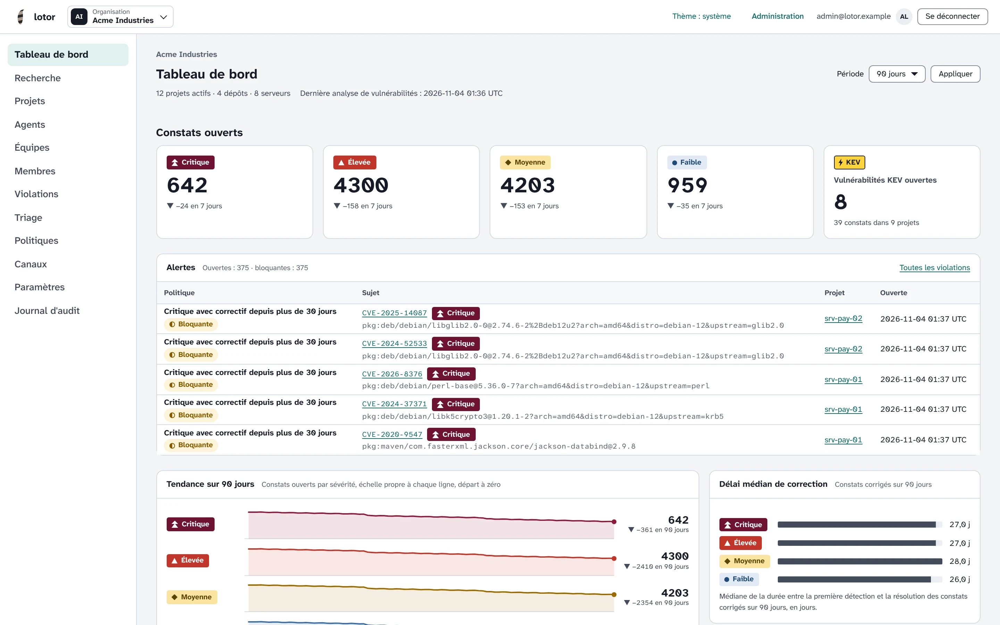
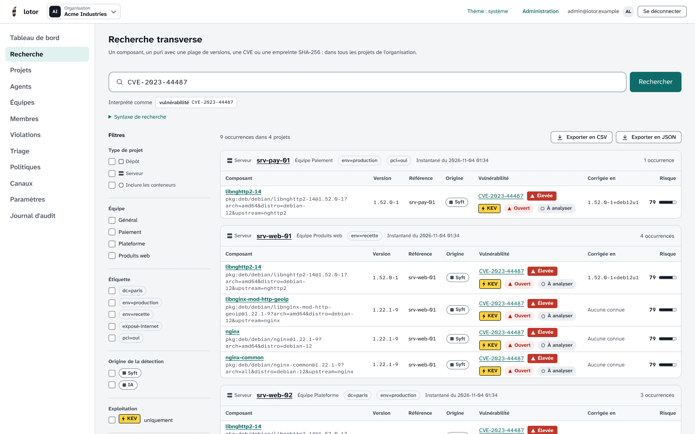
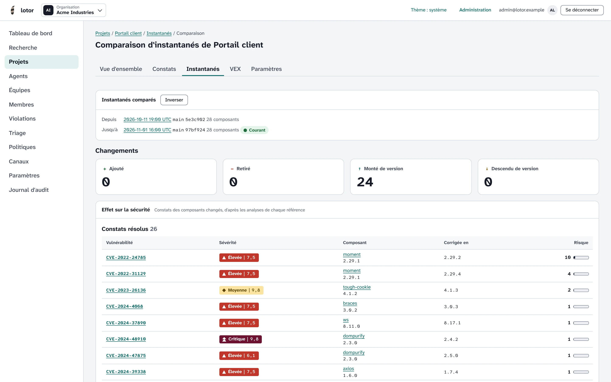
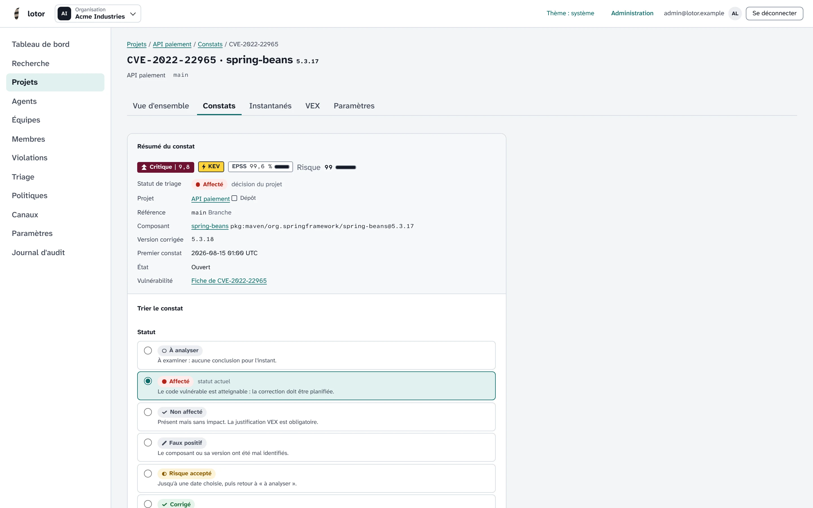
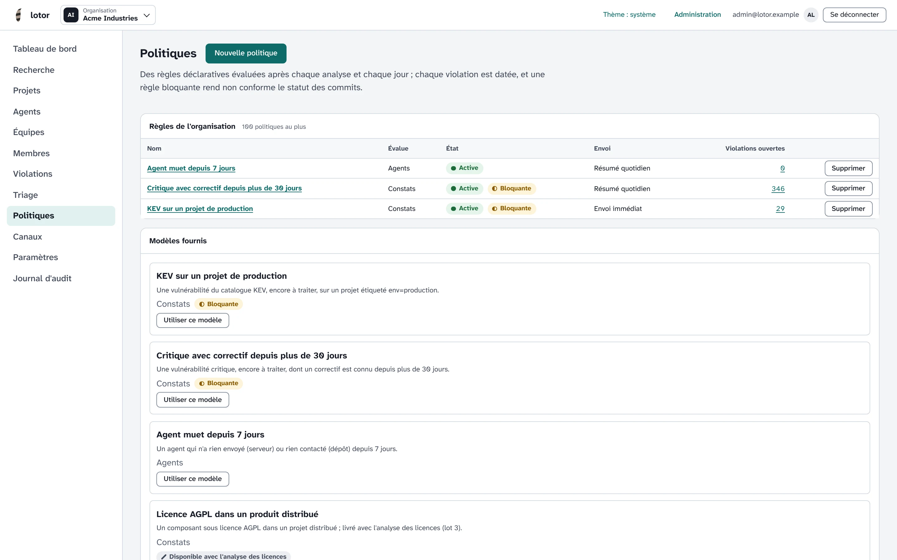
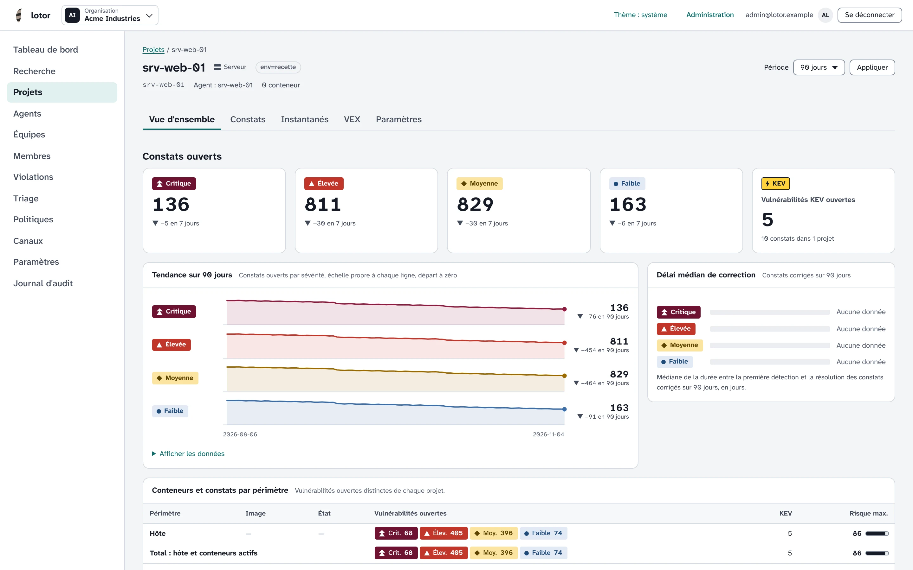
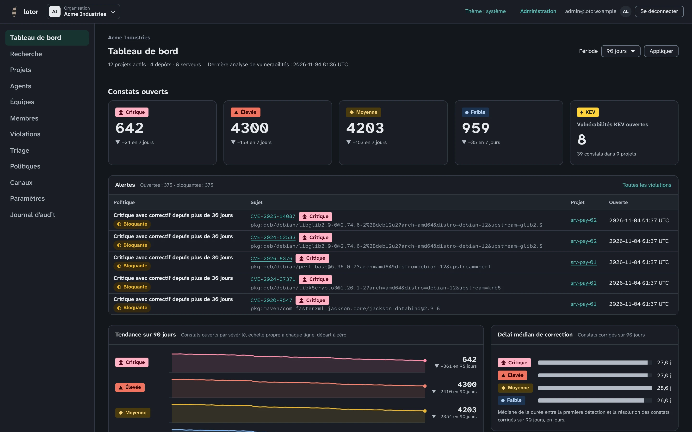

# lotor

*[Version française](README.fr.md)*

**A CVE drops. You know who is affected.**

Every day, lotor inventories the software on your **servers**, their **containers** and
your **git repositories** (SBOMs), matches it against the Grype vulnerability database, and
answers "who uses this component?" and "who is affected by this CVE?" in a single search.
Open source, self-hosted, multi-organization. Each instance introduces the tool on its home
page to signed-out visitors, with a link to sign in.

[Getting started](docs/getting-started.md) ·
[Guide de démarrage (français)](docs/demarrage.md) ·
[Installation and operations](docs/operations.md) ·
[Releases](https://github.com/leblanc-simon/lotor/releases)



## Why lotor

- **Your whole fleet, effortlessly**: a lightweight agent per Linux server (deb, rpm, apk,
  Java archives, Python packages…), Docker and Podman containers as child projects of
  their host, and a repository agent hooked into GitHub and GitLab that scans every push.
- **Always up to date**: the Grype database is reloaded daily and the whole fleet
  rescanned; a new CVE shows up on your projects without the agents sending anything.
  CVSS, EPSS and the KEV catalog rank the risks.
- **One search, every answer**: by name, purl, `vers` range, CVE, GHSA or SHA-256 digest,
  across all projects at once — under 50 ms on 1,000 projects and one million components
  ([benchmarks](docs/benchmarks.md)). CSV and JSON export, API.
- **Triage, don't endure**: affected, not affected, false positive or accepted risk with an
  expiry date — decisions are logged and applied to future findings; OpenVEX and CycloneDX
  export, import of vendor VEX documents.
- **Your rules, enforced**: CEL policies, dated violations, alerts by email, signed
  webhook, Matrix, Mattermost or Slack, blocking commit status on the forge.
- **History that speaks**: dated snapshots, comparison of two versions with their security
  impact, trends and median time to fix.
- **Optional, evidence-backed AI**: a local model (Ollama) or Anthropic, when authorized,
  looks for dependencies no manifest declares; every finding is verified and comes with its
  proof.

## Screenshots

| | |
| --- | --- |
|  |  |
| **Cross-project search** — who is affected by HTTP/2 "Rapid Reset"? | **Snapshot comparison** — what an upgrade fixed |
|  |  |
| **Triage and VEX** — a justified, traced, exportable decision | **Policies and alerts** — built-in templates, blocking rules |
|  |  |
| **Server page** — findings, trend, containers | **Dark theme** — and an accessibility-audited interface (RGAA) |

<sub>Screenshots from a demo instance: real Debian 12 and Ubuntu 24.04 packages, npm,
Maven, PyPI and Go dependencies, current Grype database.</sub>

## How it works

| Binary | Role |
| --- | --- |
| `lotor-host-agent` | host agent: inventory of a Linux host and its containers (deb and rpm packages) |
| `lotor-repo-agent` | repository agent: clones forge repositories and scans them with Syft, optional AI enrichment (deb package) |
| `lotor-server` | web interface (French, English), REST API, Grype scanning, policies and notifications |

Agents build SBOMs with Syft and only send what changed; the server keeps their history
and scans them. A single dependency: PostgreSQL. Accepted formats: CycloneDX JSON 1.5 to
1.7, SPDX JSON 2.3, Syft JSON.

## Security and sovereignty

- Self-hosted, no telemetry; air-gapped sites supported (manual import of the
  vulnerability database).
- Strictly separated organizations, isolation enforced by PostgreSQL (row-level
  security); teams and roles (reader, analyst, administrator); audit log.
- Mandatory TOTP second factor, recovery codes; revocable agent tokens, optional mTLS,
  secrets encrypted at rest. [Threat model](docs/security/threat-model.md).

## Install

On Debian 13 or Ubuntu 24.04, the server package creates the local PostgreSQL database,
the secrets, the first administrator and the nginx or Apache site:

```bash
sudo apt install ./lotor-server_0.3.3_amd64.deb
```

Agents, manual installation and configuration: [`docs/operations.md`](docs/operations.md).
Status: pre-release **0.3.3** (teams and permissions, containers, triage and VEX, policies
and alerts, snapshot diffs, AI enrichment, Dependency-Track compatibility, offline mode,
licenses, point-in-time search, sign-up); changes: [`CHANGELOG.md`](CHANGELOG.md).

## Development

Requirements: Go 1.26, `make`, PostgreSQL 16 for the integration tests
(`docker compose -f deploy/compose.yaml up -d`).

```bash
make ci        # every check, same as the CI
make build     # bin/lotor-server, bin/lotor-host-agent, bin/lotor-repo-agent
make run       # local server (cp config.example.yaml config.yaml)
make help      # list of targets
```

## Documentation

Except for the getting started guide, the documentation is written in French.

- [Requirements](docs/cahier-des-charges.md)
- [Reference architecture](specs/architecture.md)
- [Technical work packages](specs/README.md)
- [User guide](docs/utilisation.md)
- [Notifications](docs/notifications.md)
- [Operations](docs/operations.md)
- [Benchmarks](docs/benchmarks.md)
- [Changelog](CHANGELOG.md)
- [Architecture decision records](docs/adr/)
- [Threat model](docs/security/threat-model.md)

## License

[WTFPL](LICENSE).
