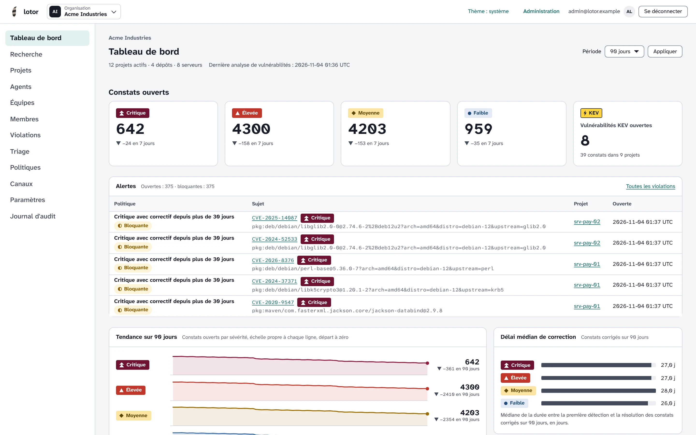
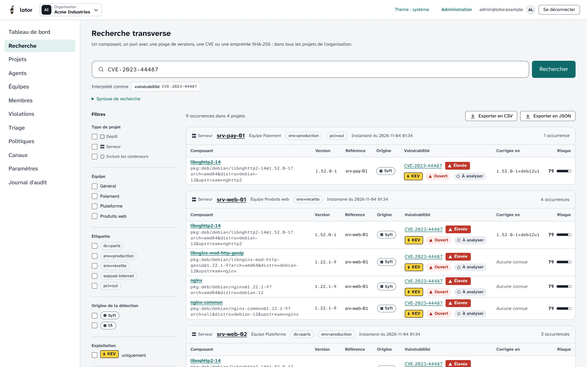
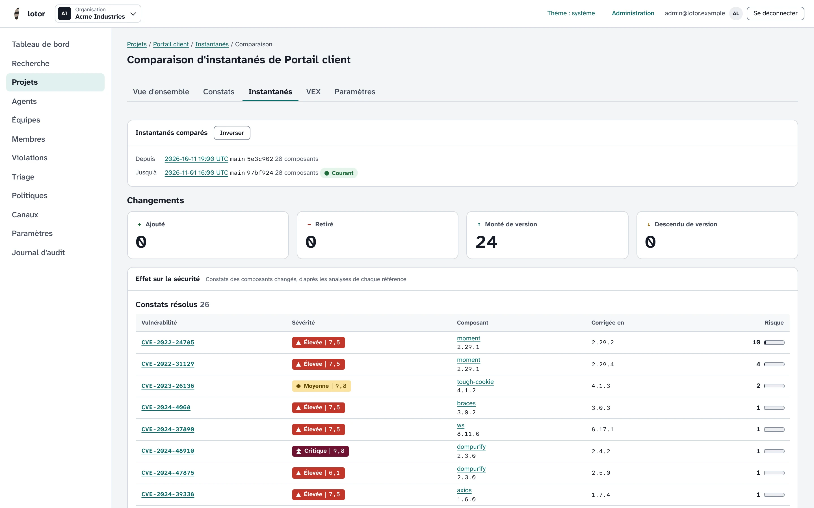
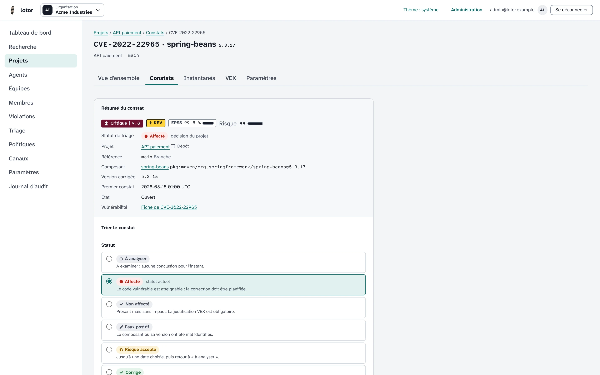
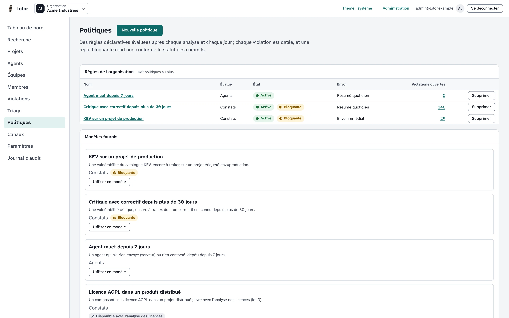
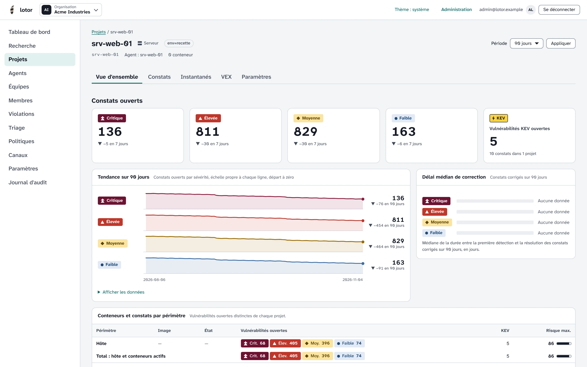
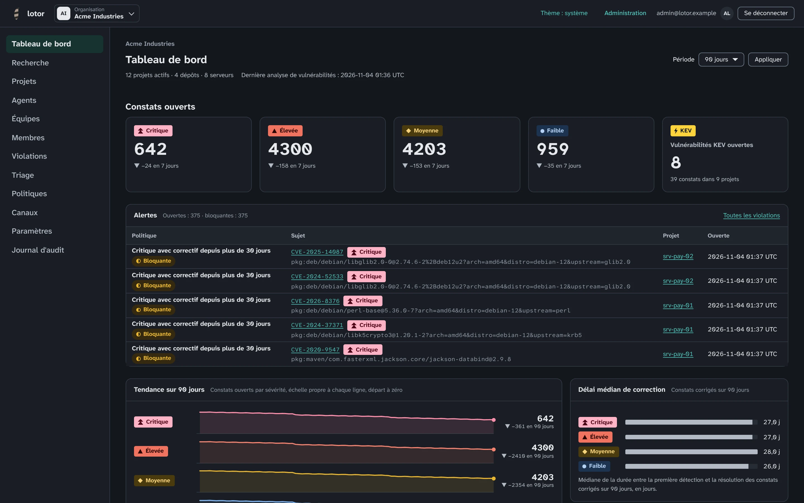

# lotor

**Une CVE tombe. Vous savez qui est touché.**

lotor inventorie chaque jour les logiciels de vos **serveurs**, de leurs **conteneurs** et
de vos **dépôts git** (SBOM), les confronte à la base de vulnérabilités Grype et répond en
une recherche à « qui utilise ce composant ? » et « qui est touché par cette CVE ? ».
Open source, auto-hébergé, multi-organisation. Chaque instance présente l'outil sur sa page
d'accueil aux visiteurs non connectés, avec un lien vers la connexion.

[Guide de démarrage](docs/demarrage.md) ·
[Getting started (English)](docs/getting-started.md) ·
[Installation et exploitation](docs/operations.md) ·
[Versions](https://github.com/leblanc-simon/lotor/releases)



## Pourquoi lotor

- **Tout le parc, sans effort** : un agent léger par serveur Linux (deb, rpm, apk, archives
  Java, paquets Python…), les conteneurs Docker et Podman en projets enfants de leur hôte,
  et un agent dépôt branché sur GitHub et GitLab qui analyse chaque push.
- **Toujours à jour** : la base Grype est rechargée chaque jour et tout le parc réanalysé ;
  une nouvelle CVE apparaît sur vos projets sans que les agents ne renvoient rien. CVSS,
  EPSS et catalogue KEV classent les risques.
- **Une recherche, toutes les réponses** : par nom, purl, plage `vers`, CVE, GHSA ou
  empreinte SHA-256, sur tous les projets à la fois — moins de 50 ms sur 1 000 projets et
  un million de composants ([mesures](docs/benchmarks.md)). Export CSV et JSON, API.
- **Trier, pas subir** : décisions affecté, non affecté, faux positif ou risque accepté
  avec échéance, journalisées et appliquées aux constats futurs ; export OpenVEX et
  CycloneDX, import des VEX d'éditeurs.
- **Vos règles, appliquées** : politiques en CEL, violations datées, alertes par e-mail,
  webhook signé, Matrix, Mattermost ou Slack, statut de commit bloquant sur la forge.
- **L'historique qui parle** : instantanés datés, comparaison de deux versions avec
  l'effet sur la sécurité, tendances et délai médian de correction.
- **IA facultative et prouvée** : un modèle local (Ollama) ou Anthropic, sur autorisation,
  cherche les dépendances qu'aucun manifeste ne déclare ; chaque trouvaille est vérifiée
  et accompagnée de sa preuve.

## En images

| | |
| --- | --- |
|  |  |
| **Recherche transverse** — qui est touché par HTTP/2 « Rapid Reset » ? | **Comparaison d'instantanés** — ce qu'une montée de version a corrigé |
|  |  |
| **Triage et VEX** — une décision justifiée, tracée, exportable | **Politiques et alertes** — modèles fournis, règles bloquantes |
|  |  |
| **Fiche d'un serveur** — constats, tendance, conteneurs | **Thème sombre** — et interface auditée RGAA |

<sub>Captures d'une instance de démonstration : paquets réels de Debian 12 et Ubuntu 24.04,
dépendances npm, Maven, PyPI et Go, base Grype du jour.</sub>

## Comment ça marche

| Binaire | Rôle |
| --- | --- |
| `lotor-host-agent` | agent serveur : inventaire d'un hôte Linux et de ses conteneurs (paquets deb et rpm) |
| `lotor-repo-agent` | agent dépôt : clonage des dépôts des forges et analyse Syft, enrichissement IA facultatif (paquet deb) |
| `lotor-server` | interface web (français, anglais), API REST, analyse Grype, politiques et notifications |

Les agents produisent les SBOM avec Syft et n'envoient que ce qui a changé ; le serveur
les historise et les analyse. Une seule dépendance : PostgreSQL. Formats reçus :
CycloneDX JSON 1.5 à 1.7, SPDX JSON 2.3, Syft JSON.

## Sécurité et souveraineté

- Auto-hébergé, sans télémétrie ; site isolé possible (import manuel de la base de
  vulnérabilités).
- Organisations étanches, isolement imposé par PostgreSQL (sécurité au niveau des
  lignes) ; équipes et rôles (lecteur, analyste, administrateur) ; journal d'audit.
- Second facteur TOTP obligatoire, codes de secours ; jetons d'agent révocables, mTLS en
  option, secrets chiffrés au repos. [Modèle de menace](docs/security/threat-model.md).

## Installer

Sur Debian 13 ou Ubuntu 24.04, le paquet du serveur crée la base PostgreSQL locale, les
secrets, le premier administrateur et le site nginx ou Apache :

```bash
sudo apt install ./lotor-server_0.3.2_amd64.deb
```

Agents, installation manuelle et configuration : [`docs/operations.md`](docs/operations.md).
État : préversion **0.3.2** (équipes et droits, conteneurs, triage et VEX, politiques et
alertes, différences d'instantanés, enrichissement IA, compatibilité Dependency-Track, mode
hors ligne, licences, recherche à une date passée, inscription) ; évolutions :
[`CHANGELOG.md`](CHANGELOG.md).

## Développement

Prérequis : Go 1.26, `make`, PostgreSQL 16 pour les tests d'intégration
(`docker compose -f deploy/compose.yaml up -d`).

```bash
make ci        # toutes les vérifications, identiques à la CI
make build     # bin/lotor-server, bin/lotor-host-agent, bin/lotor-repo-agent
make run       # serveur local (cp config.example.yaml config.yaml)
make help      # liste des cibles
```

## Documentation

- [Cahier des charges](docs/cahier-des-charges.md)
- [Architecture de référence](specs/architecture.md)
- [Lots techniques](specs/README.md)
- [Guide d'utilisation](docs/utilisation.md)
- [Notifications](docs/notifications.md)
- [Exploitation](docs/operations.md)
- [Mesures de performance](docs/benchmarks.md)
- [Journal des modifications](CHANGELOG.md)
- [Décisions d'architecture](docs/adr/)
- [Modèle de menace](docs/security/threat-model.md)

## Licence

[WTFPL](LICENSE).
